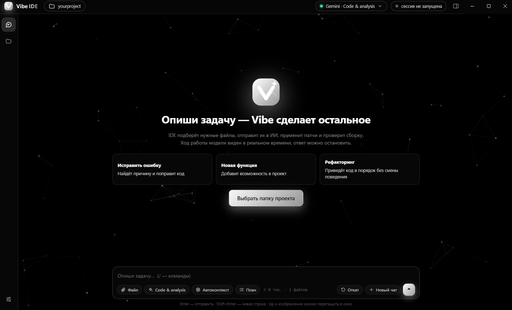

# Vibe

**English** | [Русский](#ru)

**Status:** beta · **Version:** `0.01.1` · **OS:** Windows · **Python:** 3.10+ · **IDE:** Electron (Node.js 18+) · **License:** MIT

> A local "vibe coder" that runs on your **chat subscription**, not a paid API. Vibe drives a Chrome window where an AI chat is already open (Gemini, Claude or Google AI Studio), sends it your project context, reads the answer and applies the patches to your files.

**Vibe CLI** is the command line tool. **Vibe IDE** is an optional Electron GUI on top of it: chat, project tree, change panel and log.



> ⚠️ **Unofficial project.** Vibe is not affiliated with, endorsed by or sponsored by Google or Anthropic. It automates the web interfaces of third-party services, which may be against their Terms of Service and may lead to limits or a ban on your account. **Use at your own risk.** See [Disclaimer](#disclaimer-and-privacy).

> ⚠️ **Beta software.** It depends on the page layout of the chat sites, so a site update can break it until the selectors are fixed. Tested on **Windows 11 (26H2)** with **Google Chrome 157.0.8103.50**. Windows only for now; macOS and Linux are not supported. See [Known limitations](#known-limitations).

---

## Quick start

```bash
# 1. Install (creates .venv and installs requirements.txt)
scripts\install_windows.bat

# 2. Start Chrome with a debug port and sign in once
scripts\start_chrome_windows.bat       # Gemini / AI Studio (port 9222)

# 3. Run in your project folder
python vibe.py --dir path/to/project
```

Then type a task, for example: `add a logout button to the header`.

Shortcut: `run_vibe.bat`. For the GUI see [Vibe IDE](#vibe-ide).

---

## Features

- **Three providers:** Gemini, Claude, AI Studio. Work goes through your own Chrome with a remote debugging port (CDP).
- **SEARCH/REPLACE patches:** the model answer is parsed automatically. Supported blocks: `<<<FILE>>>`, `<<<CREATE>>>`, `<<<DELETE>>>`, `<<<RUN_CMD>>>`. The last patch can be rolled back with `/undo`.
- **Auto-heal:** after patching, a verify command runs; on failure the log goes back to the model until it passes or attempts run out.
- **Auto context:** only the files relevant to the task are sent. If the model needs another file, it requests it with `NEED_FILES`.
- **Two-phase mode:** plan first, code second (`/plan`).
- **Varied prompts:** the chat message depends on the task type (bug, feature, refactoring, UI, tests, docs, optimization). `classic` style uses a fixed text.
- **Attachments:** zip and images (png, jpg, webp, gif, bmp, up to 25 MB).
- **Context transport formats:** auto, file, paste, inline, zip, base64.
- **Models read from the site:** model and reasoning-level names are read from the UI instead of being hard-coded, cached in JSON and refreshed automatically. Promo banners, settings and models locked on your plan (e.g. on the free plan) are filtered out of the list.
- **`yolo` mode:** plans are approved and commands run without asking. See the [warning](#disclaimer-and-privacy).
- **Stop** a running answer and **continue** it (`/continue`).
- **English and Russian:** the CLI, the IDE and the prompts sent to the model speak both languages. Pick one with `--lang`, `/lang` or the IDE settings; by default it follows your system language.
- **Vibi the cat:** the CLI has its own look with the Vibe mascot, see [Language and Vibi](#language-and-vibi).

---

## Requirements

- Windows 10 / 11
- Python 3.10+ (added to PATH)
- Google Chrome
- Node.js 18+ (Vibe IDE only)
- An account at the chosen service (Gemini / Claude / AI Studio)

---

## Installation

```bat
scripts\install_windows.bat
```

The script creates a `.venv` virtual environment and installs `requirements.txt`.

For the IDE:

```bash
cd .vibeide
npm install
npm start
```

---

## Starting Chrome

The CLI attaches to Chrome through a debugging port. You sign in to your account once; the profile is kept between runs.

| Provider | Port | Script |
|---|---|---|
| Gemini and AI Studio | 9222 | `scripts\start_chrome_windows.bat` |
| Claude | 9223 | `scripts\start_chrome_claude_windows.bat` |

Gemini and AI Studio share one Google account and, by default, one Chrome. The IDE can run these scripts automatically (see [IDE settings](#ide-settings)).

---

## Usage

```bash
python vibe.py --dir path/to/project
```

One-shot task:

```bash
python vibe.py --dir . "add a logout button to the header"
```

### Arguments

| Argument | Description |
|---|---|
| `--dir`, `-d` | project folder |
| `--plan`, `-p` | plan first, then code |
| `--yolo`, `-y` | no confirmations |
| `--provider` | `gemini`, `claude`, `aistudio` |
| `--model` | model (number or part of the name from the site list) |
| `--reasoning` | reasoning level |
| `--transport` | `auto`, `file`, `paste`, `inline`, `zip`, `base64` |
| `--auto-context` | `on` / `off` |
| `--prompt-style` | `auto` / `classic` |
| `--lang` | `en`, `ru` or `auto` (system language) |

### Chat commands

| Command | What it does |
|---|---|
| `/plan <task>` | plan, then code |
| `/model [name\|number] [level]` | list models from the site or pick one |
| `/reasoning low\|medium\|high\|off` | reasoning level |
| `/provider gemini\|claude\|aistudio` | switch provider |
| `/transport [format]` | context transport format |
| `/autocontext on\|off` | auto context |
| `/autocontext_set <files> [tokens]` | auto-context limits |
| `/promptstyle auto\|classic` | prompt texts |
| `/lang en\|ru\|auto` | interface and prompt language |
| `/attach <path>` | attach a zip or image to the next message |
| `/attach_clear` | remove attachments |
| `/yolo on\|off` | no-confirmation mode |
| `/verify_cmd <command>` | verify command after patches |
| `/fix [command]` | run the check and fix errors |
| `/check_ui [url]` | check the frontend in a headless browser |
| `/undo` | roll back the last patch |
| `/context` | show what goes into the context |
| `/continue` | continue a stopped answer |
| `/reset` | new chat |
| `/init` | create `.vibe.json` and `VIBE.md` |
| `/help`, `/exit` | help, quit |

Commands can be shortened to an unambiguous prefix (`/und` → `/undo`).

### Context transport formats

| Format | How it works |
|---|---|
| `auto` | tries in turn: file → paste → ZIP → base64 file → text, until the chat sees the context (AI Studio tries text first) |
| `file` | a `.txt` attached through the "+" button |
| `paste` | the same `.txt`, inserted like a clipboard paste/drop |
| `inline` | the whole context as message text |
| `zip` | context in a `.zip` archive, attached as a file |
| `base64` | context encoded in base64 and attached as a separate `.txt` |

The format applies from a new chat.

---

## Vibe IDE

A graphical shell: chat, project tree with file selection for the context, change panel and log.

- **Chat** with execution steps, live view of the answer and a stop button (`Esc`).
- **Attachments:** paperclip button, drag-and-drop into the window, or pasting an image from the clipboard.
- **Context:** project tree, `.vibeignore` exclusions, token counter.
- **Model picker:** a list read from the site (search, reasoning levels, last update time).
- **Look:** themes, accent color, density, font, rounding, animations and a particle background.

### IDE settings

| Section | What you can set |
|---|---|
| Appearance | theme, accent, density, font size, rounding, chat width, effects |
| Features | auto context and limits, progress display, "No confirmations", prompt texts, transport format, answer timeout |
| Connection | Chrome autostart, autostart scripts on IDE launch, custom scripts, automatic model-list refresh |

**Autostart scripts.** On launch the IDE can run `scripts\start_chrome_*.bat` for the selected provider or for Gemini and Claude together. You can add your own scripts, one path per line (relative paths are resolved from the Vibe folder).

**Model lists.** Model and reasoning-level names are read from the site and stored in `models-cache.json` in the app data folder. They refresh hourly by default (change the interval in settings, `0` disables it), and there is a "Refresh now" button. A running Chrome is required.

---

## Language and Vibi

**Language.** Vibe CLI and Vibe IDE come in English and Russian. The language is chosen in this order:

1. `--lang en|ru` or the `/lang en|ru` command (saved to `.vibe.json` as `"language"`; the IDE has a selector in *Settings → Appearance*);
2. the `VIBE_LANG` environment variable (`en`, `ru` or `auto`);
3. `auto`: the language of your operating system (Russian system → Russian, anything else → English).

The language also decides which prompt pack is sent to the chat (`core/prompts.py` for Russian, `core/prompts_en.py` for English). The patch-format markers (`<<<FILE>>>`, `SEARCH/REPLACE` …) are identical in both, so patching works the same.

**Vibi.** The CLI has its own look built around Vibi, a square pixel-art cat (purple body, teal ear tips, pink cheeks, a little «ω» mouth). She greets you in the banner and plays an idle animation (blinks, looks around, twitches an ear) for a few seconds; and with every new message she runs back and forth across the terminal while the model is answering. In terminals that can show images (Windows Terminal 1.22+, Kitty, Ghostty, iTerm2, WezTerm) she is a real picture, elsewhere colour pixels, and on small or plain terminals a small blinking `[•ω•]` next to the status line. The classic console window (cmd) cannot show pictures, so `run_vibe.bat` reopens itself in Windows Terminal when it is installed (`VIBE_NO_WT=1` skips that). Force a mode with `VIBE_IMAGES=sixel|kitty|iterm|blocks`; if the picture is too big or small in Windows Terminal, set `VIBE_IMG_SCALE` or `VIBE_CELL_PX=WxH`. Her face in the prompt shows how the last task went (`[•ω•]` idle, `[^ω^]` success, `[×n×]` error, `[-ω-]` stopped). She has moods: idle, happy, think, work, error, sleep. Colours match Vibe IDE (violet `#7c5cff` → teal `#14d6c4`). Use `VIBE_NO_ANIM=1` to turn the animation off; with `VIBE_ASCII=1`, or if the terminal encoding is not UTF-8, a plain ASCII Vibi is used (`VIBE_UNICODE=1` forces the block-character one).

```
  ╱╲             ╱╲
 ╱  ╲___________╱  ╲
 │                 │
 │   ●         ●   │
 │        ω        │
 ╰─────────────────╯
```

**Adding a language.** Source strings in the code are Russian and act as message ids: `t("Русский текст")` returns the text from `core/locale_en.py` (CLI) or `.vibeide/renderer/locale-en.js` (IDE). A missing entry falls back to the source text. `python -m pytest tests` (`tests/test_i18n.py`) and `node .vibeide/check-i18n.js` check that no string is missing.

---

## Configuration

Project settings live in `.vibe.json` (created by `/init`).

```json
{
  "provider": "gemini",
  "models": { "gemini": "", "claude": "", "aistudio": "" },
  "reasonings": { "gemini": "", "claude": "", "aistudio": "" },
  "verify_cmd": "npm run build",
  "max_heal_retries": 4,
  "transport": "auto",
  "auto_context": false,
  "auto_context_max_files": 24,
  "auto_context_budget": 30000,
  "prompt_style": "auto",
  "language": "auto",
  "ignore": ["docs/"],
  "selector_overrides": {}
}
```

- `.vibeignore` — exclusions from the context, `.gitignore` syntax.
- `VIBE.md` — your project rules, added to the context.
- `selector_overrides` — your own CSS selectors if a site changes its UI, e.g. `{"aistudio": {"model_btn": ["..."]}}`.
- Environment variables: `VIBE_PROVIDER`, `VIBE_MODEL`, `VIBE_TRANSPORT`, `VIBE_AUTO_CONTEXT`, `VIBE_PROMPT_STYLE`, `VIBE_VERIFY_CMD`, `VIBE_LANG` and others, see `.env.example`.
- Whether to commit `.vibe.json` and `VIBE.md` to your own project is up to you: `VIBE.md` is useful to share with a team, `.vibe.json` is more personal.

---

## Disclaimer and privacy

- **Terms of Service.** Vibe automates the web interfaces of Gemini, Claude and Google AI Studio through your browser. This may violate their terms and can result in rate limits or account suspension. The author takes no responsibility for that.
- **Your code leaves your machine.** The project context (selected files, optionally attachments) is sent to the chat service you chose, under that service's own privacy policy. Do not include secrets: use `.vibeignore` to exclude `.env`, keys and private data.
- **`yolo` mode runs commands from the model.** `<<<RUN_CMD>>>` blocks are arbitrary shell commands executed on your machine. In `yolo` mode they run without asking. Enable it only in projects you are ready to lose, ideally under version control.
- **Patches change your files.** Commit before a session; `/undo` reverts only the last patch.
- **Chrome profile.** The debug-port Chrome keeps your signed-in session. Do not expose the debug port (9222 / 9223) to the network.
- The author receives no data from Vibe.

---

## Project structure

```
vibe.py                 CLI entry point
core/
  prompts.py            Russian prompt texts and per-task hints
  prompts_en.py         English prompt texts
  i18n.py, locale_en.py interface language: t() and the English catalog
  mascot.py, sprites.py, vibi_run.py, ui.py   Vibi the mascot (pixel frames, running cat) and the look of the CLI
  gemini_bridge.py      chat control through Chrome (sending, attachments, models)
  providers.py          Gemini / Claude / AI Studio profiles
  config.py             settings, transport formats
  context_packer.py     packing the project into a context
  context_selector.py   choosing files for a task
  patcher.py            parsing and applying patches
  runner.py             running commands, UI check
  commands.py           command parsing
  events.py             CLI ↔ IDE protocol
.vibeide/               Vibe IDE (Electron)
scripts/                install and Chrome launch scripts
tests/                  tests
```

---

## Troubleshooting

- **Chrome does not respond** — run the right script from `scripts/` and sign in.
- **Model list is empty or shows old items** — start Chrome for that provider and press "Refresh from site" (the list is cached).
- **The chat "does not see" the context** — change the transport (`/transport zip` or `/transport inline`) and start a new chat (`/reset`).
- **A site changed its UI** — adjust `selector_overrides`.
- **SEARCH blocks did not match** — the CLI sends the model the current files and asks it to rewrite the edits.

## Known limitations

- Depends on third-party page layouts; updates on their side can break it.
- Windows only: macOS and Linux are not supported yet.
- Needs a running Chrome with a debug port; headless/server use is not supported.
- Tested on one setup only (Windows 11 26H2, Chrome 157.0.8103.50).
- Chat limits of your subscription still apply.
- Attachments depend on what the chat site allows.

## Tests

```bash
pip install pytest
python -m pytest tests
node .vibeide/check-i18n.js    # IDE translations
```

## Contributing

Bug reports, test reports (OS, Chrome version, provider) and pull requests are welcome. When reporting a problem, include the provider, transport format and the CLI log.

## License

MIT, see [LICENSE](LICENSE).

---
---

<a name="ru"></a>

# Vibe (русская версия)

[English](#vibe) | **Русский**

**Статус:** бета · **Версия:** `0.01.1` · **ОС:** Windows · **Python:** 3.10+ · **IDE:** Electron (Node.js 18+) · **Лицензия:** MIT

> Локальный «вайбкодер» на **подписке на чат**, без платного API. Vibe управляет вашим Chrome с открытым чатом ИИ (Gemini, Claude или Google AI Studio), отправляет туда контекст проекта, получает ответ и применяет патчи к файлам.

**Vibe CLI** — консольная утилита. **Vibe IDE** — необязательная графическая оболочка (Electron): чат, дерево проекта, панель изменений и журнал.

> ⚠️ **Неофициальный проект.** Vibe не связан с Google и Anthropic и не одобрен ими. Он автоматизирует веб-интерфейсы сторонних сервисов, что может противоречить их условиям использования и привести к ограничениям или блокировке аккаунта. **Используйте на свой риск.** См. [Отказ от ответственности](#отказ-от-ответственности-и-приватность).

> ⚠️ **Бета-версия.** Проект зависит от вёрстки сайтов чатов, поэтому их обновление может сломать работу, пока не поправлены селекторы. Проверено на **Windows 11 (26H2)** и **Google Chrome 157.0.8103.50**. Пока только Windows; macOS и Linux не поддерживаются. См. [Известные ограничения](#известные-ограничения).

---

## Быстрый старт

```bash
# 1. Установка (создаёт .venv и ставит requirements.txt)
scripts\install_windows.bat

# 2. Запустите Chrome с портом отладки и войдите в аккаунт (один раз)
scripts\start_chrome_windows.bat       # Gemini / AI Studio (порт 9222)

# 3. Запустите в папке проекта
python vibe.py --dir путь/к/проекту
```

Дальше введите задачу, например: `добавь кнопку выхода в шапку`.

Есть ярлык запуска `run_vibe.bat`. Графическая оболочка описана в разделе [Vibe IDE](#vibe-ide-1).

---

## Возможности

- **Три провайдера:** Gemini, Claude, AI Studio. Работа идёт через ваш Chrome с отладочным портом (CDP).
- **Патчи SEARCH/REPLACE:** ответ модели разбирается автоматически. Поддерживаются блоки `<<<FILE>>>`, `<<<CREATE>>>`, `<<<DELETE>>>`, `<<<RUN_CMD>>>`. Последний патч можно откатить командой `/undo`.
- **Авто-починка:** после патчей запускается команда проверки; при ошибке лог уходит модели, пока проверка не пройдёт или не кончатся попытки.
- **Автоподбор контекста:** в чат уходят только нужные по описанию задачи файлы. Если модели не хватает файла, она запрашивает его через `NEED_FILES`.
- **Двухфазный режим:** сначала план, потом код (`/plan`).
- **Разные промпты:** текст сообщения зависит от типа задачи (баг, фича, рефакторинг, интерфейс, тесты, документация, оптимизация). Стиль `classic` — фиксированный текст.
- **Вложения:** zip и изображения (png, jpg, webp, gif, bmp, до 25 МБ).
- **Форматы отправки контекста:** auto, file, paste, inline, zip, base64.
- **Модели с сайта:** названия моделей и уровней рассуждений читаются из интерфейса, а не зашиты в код; список кэшируется в JSON и обновляется автоматически. Рекламные баннеры, настройки и модели, недоступные в вашем плане (например, на free), в список не попадают.
- **Режим `yolo`:** планы утверждаются и команды выполняются без вопросов. См. [предупреждение](#отказ-от-ответственности-и-приватность).
- **Остановка** ответа и **продолжение** (`/continue`).
- **Английский и русский:** CLI, IDE и промпты для модели работают на обоих языках. Язык выбирается через `--lang`, `/lang` или настройки IDE; по умолчанию — язык системы.
- **Кот Vibi:** у CLI свой облик с маскотом Vibe, см. [Язык и Vibi](#язык-и-vibi).

---

## Требования

- Windows 10 / 11
- Python 3.10+ (добавлен в PATH)
- Google Chrome
- Node.js 18+ (только для Vibe IDE)
- Аккаунт в выбранном сервисе (Gemini / Claude / AI Studio)

---

## Установка

```bat
scripts\install_windows.bat
```

Скрипт создаёт виртуальное окружение `.venv` и ставит зависимости из `requirements.txt`.

Для IDE:

```bash
cd .vibeide
npm install
npm start
```

---

## Запуск Chrome

CLI подключается к Chrome по порту отладки. Войти в аккаунт нужно один раз, профиль сохраняется между запусками.

| Провайдер | Порт | Скрипт |
|---|---|---|
| Gemini и AI Studio | 9222 | `scripts\start_chrome_windows.bat` |
| Claude | 9223 | `scripts\start_chrome_claude_windows.bat` |

Gemini и AI Studio используют один Google-аккаунт и по умолчанию один Chrome. IDE может запускать эти скрипты автоматически (см. [Настройки IDE](#настройки-ide)).

---

## Использование

```bash
python vibe.py --dir путь/к/проекту
```

Одноразовая задача:

```bash
python vibe.py --dir . "добавь кнопку выхода в шапку"
```

### Аргументы

| Аргумент | Описание |
|---|---|
| `--dir`, `-d` | папка проекта |
| `--plan`, `-p` | сначала план, потом код |
| `--yolo`, `-y` | без подтверждений |
| `--provider` | `gemini`, `claude`, `aistudio` |
| `--model` | модель (номер или часть названия из списка на сайте) |
| `--reasoning` | уровень рассуждений |
| `--transport` | `auto`, `file`, `paste`, `inline`, `zip`, `base64` |
| `--auto-context` | `on` / `off` |
| `--prompt-style` | `auto` / `classic` |
| `--lang` | `en`, `ru` или `auto` (язык системы) |

### Команды в чате

| Команда | Что делает |
|---|---|
| `/plan <задача>` | план, затем код |
| `/model [имя\|номер] [уровень]` | список моделей с сайта или выбор модели |
| `/reasoning low\|medium\|high\|off` | уровень рассуждений |
| `/provider gemini\|claude\|aistudio` | сменить провайдера |
| `/transport [формат]` | формат отправки контекста |
| `/autocontext on\|off` | автоподбор контекста |
| `/autocontext_set <файлов> [токенов]` | лимиты автоподбора |
| `/promptstyle auto\|classic` | тексты промптов |
| `/lang en\|ru\|auto` | язык интерфейса и промптов |
| `/attach <путь>` | прикрепить zip или изображение к следующему сообщению |
| `/attach_clear` | убрать вложения |
| `/yolo on\|off` | режим без подтверждений |
| `/verify_cmd <команда>` | команда проверки после патчей |
| `/fix [команда]` | прогнать проверку и починить ошибки |
| `/check_ui [url]` | проверить фронтенд в headless-браузере |
| `/undo` | откатить последний патч |
| `/context` | что попадёт в контекст |
| `/continue` | продолжить остановленный ответ |
| `/reset` | новый чат |
| `/init` | создать `.vibe.json` и `VIBE.md` |
| `/help`, `/exit` | справка, выход |

Команды можно сокращать до однозначного префикса (`/und` → `/undo`).

### Форматы отправки контекста

| Формат | Как работает |
|---|---|
| `auto` | пробует по очереди: файл → вставка → ZIP → base64-файл → текст, пока чат не увидит контекст (у AI Studio текст идёт первым) |
| `file` | `.txt` файлом через кнопку «+» в чате |
| `paste` | тот же `.txt`, но вставкой как из буфера (paste/drop) |
| `inline` | весь контекст текстом в сообщении |
| `zip` | контекст в архиве `.zip`, прикрепляется файлом |
| `base64` | контекст кодируется в base64 и прикрепляется отдельным `.txt`-файлом |

Формат применяется с нового чата.

---

## Vibe IDE

Графическая оболочка: чат, дерево проекта с выбором файлов для контекста, панель изменений и журнал.

- **Чат** с шагами выполнения, живым просмотром ответа и кнопкой остановки (`Esc`).
- **Вложения:** кнопка-скрепка, перетаскивание файлов в окно или вставка изображения из буфера.
- **Контекст:** дерево проекта, исключения `.vibeignore`, подсчёт токенов.
- **Выбор модели:** окно со списком, прочитанным с сайта (поиск, уровни рассуждений, время последнего обновления).
- **Оформление:** темы, акцентный цвет, плотность, шрифт, скругления, анимации и фон с частицами.

### Настройки IDE

| Раздел | Что настраивается |
|---|---|
| Оформление | тема, акцент, плотность, размер шрифта, скругление, ширина чата, эффекты |
| Функции | автоконтекст и его лимиты, показ хода работы, «Без подтверждений», тексты промптов, формат отправки контекста, таймаут ответа |
| Подключение | автозапуск Chrome, автозапуск батников при старте IDE, свои скрипты, автообновление списков моделей |

**Автозапуск батников.** При открытии IDE можно запускать `scripts\start_chrome_*.bat` для выбранного провайдера или для Gemini и Claude сразу. Можно добавить свои скрипты, по одному пути в строке (относительные пути считаются от папки Vibe).

**Списки моделей.** Названия моделей и уровней рассуждений читаются с сайта и хранятся в `models-cache.json` в папке данных приложения. По умолчанию они обновляются раз в час (интервал меняется в настройках, `0` — выключить), есть кнопка «Обновить сейчас». Нужен запущенный Chrome.

---

## Язык и Vibi

**Язык.** Vibe CLI и Vibe IDE работают на английском и русском. Язык выбирается так:

1. `--lang en|ru` или команда `/lang en|ru` (сохраняется в `.vibe.json` как `"language"`; в IDE — переключатель в *Настройки → Оформление*);
2. переменная окружения `VIBE_LANG` (`en`, `ru` или `auto`);
3. `auto`: язык операционной системы (русская система → русский, любая другая → английский).

Язык определяет и набор промптов, который уходит в чат (`core/prompts.py` — русский, `core/prompts_en.py` — английский). Маркеры формата патчей (`<<<FILE>>>`, `SEARCH/REPLACE` …) в обоих одинаковы, поэтому патчи применяются так же.

**Vibi.** У CLI свой облик вокруг Vibi — квадратного пиксельного кота (фиолетовое тело, бирюзовые кончики ушей, розовые щёчки, маленький рот «ω»). Она встречает вас в баннере и несколько секунд играет idle-анимацию (моргает, оглядывается, дёргает ухом); а с каждым новым сообщением бегает по терминалу туда-сюда, пока модель отвечает. В терминалах с поддержкой картинок (Windows Terminal 1.22+, Kitty, Ghostty, iTerm2, WezTerm) это настоящая картинка, в остальных — цветные пиксели, а в маленьких и простых терминалах — маленькая моргающая мордочка `[•ω•]` рядом со статусом. Классическое окно консоли (cmd) картинки показать не может, поэтому `run_vibe.bat` сам перезапускается в Windows Terminal, если он установлен (`VIBE_NO_WT=1` отключает это). Режим можно задать через `VIBE_IMAGES=sixel|kitty|iterm|blocks`; если в Windows Terminal кот слишком большой или маленький — `VIBE_IMG_SCALE` или `VIBE_CELL_PX=ШxВ`. Мордочка в строке ввода показывает, как прошла прошлая задача (`[•ω•]` ждёт, `[^ω^]` успех, `[×n×]` ошибка, `[-ω-]` остановлено). Настроения: idle, happy, think, work, error, sleep. Цвета как в Vibe IDE (фиолетовый `#7c5cff` → бирюзовый `#14d6c4`). `VIBE_NO_ANIM=1` выключает анимацию; при `VIBE_ASCII=1` или если кодировка терминала не UTF-8, рисуется простая ASCII-версия (`VIBE_UNICODE=1` принудительно включает версию из блоков).

**Новый язык.** Строки в коде русские и служат ключами: `t("Русский текст")` берёт текст из `core/locale_en.py` (CLI) или `.vibeide/renderer/locale-en.js` (IDE). Если перевода нет, показывается исходный текст. Тесты `tests/test_i18n.py` и `node .vibeide/check-i18n.js` проверяют, что ничего не пропущено.

---

## Конфигурация

Настройки проекта лежат в `.vibe.json` (создаётся командой `/init`).

```json
{
  "provider": "gemini",
  "models": { "gemini": "", "claude": "", "aistudio": "" },
  "reasonings": { "gemini": "", "claude": "", "aistudio": "" },
  "verify_cmd": "npm run build",
  "max_heal_retries": 4,
  "transport": "auto",
  "auto_context": false,
  "auto_context_max_files": 24,
  "auto_context_budget": 30000,
  "prompt_style": "auto",
  "language": "auto",
  "ignore": ["docs/"],
  "selector_overrides": {}
}
```

- `.vibeignore` — исключения из контекста, синтаксис как в `.gitignore`.
- `VIBE.md` — ваши правила для проекта, добавляются в контекст.
- `selector_overrides` — свои CSS-селекторы, если сайт поменял интерфейс, например `{"aistudio": {"model_btn": ["..."]}}`.
- Переменные окружения: `VIBE_PROVIDER`, `VIBE_MODEL`, `VIBE_TRANSPORT`, `VIBE_AUTO_CONTEXT`, `VIBE_PROMPT_STYLE`, `VIBE_VERIFY_CMD`, `VIBE_LANG` и другие, см. `.env.example`.
- Коммитить ли `.vibe.json` и `VIBE.md` в свой проект, решаете вы: `VIBE.md` удобно делиться с командой, `.vibe.json` скорее личный.

---

## Отказ от ответственности и приватность

- **Условия использования.** Vibe автоматизирует веб-интерфейсы Gemini, Claude и Google AI Studio через ваш браузер. Это может нарушать их условия и привести к лимитам или блокировке аккаунта. Автор за это ответственности не несёт.
- **Ваш код уходит с компьютера.** Контекст проекта (выбранные файлы, при необходимости вложения) отправляется выбранному чат-сервису и подпадает под его политику конфиденциальности. Не включайте секреты: исключите `.env`, ключи и приватные данные через `.vibeignore`.
- **`yolo` выполняет команды из ответа модели.** Блоки `<<<RUN_CMD>>>` — это произвольные команды оболочки на вашей машине. В режиме `yolo` они запускаются без вопросов. Включайте его только в проектах, которые не жалко потерять, лучше под контролем версий.
- **Патчи меняют ваши файлы.** Делайте коммит перед сессией; `/undo` откатывает только последний патч.
- **Профиль Chrome.** Chrome с портом отладки хранит ваш вход в аккаунт. Не открывайте порты отладки (9222 / 9223) в сеть.
- Автору Vibe ничего не отправляется.

---

## Структура проекта

```
vibe.py                 точка входа CLI
core/
  prompts.py            русские тексты промптов и подсказки по типам задач
  prompts_en.py         английские тексты промптов
  i18n.py, locale_en.py язык интерфейса: t() и английский каталог
  mascot.py, sprites.py, vibi_run.py, ui.py   маскот Vibi (пиксельные кадры, бегущий кот) и оформление CLI
  gemini_bridge.py      управление чатом через Chrome (отправка, вложения, модели)
  providers.py          профили Gemini / Claude / AI Studio
  config.py             настройки, форматы отправки
  context_packer.py     упаковка проекта в контекст
  context_selector.py   автоподбор файлов под задачу
  patcher.py            разбор и применение патчей
  runner.py             запуск команд, проверка интерфейса
  commands.py           разбор команд
  events.py             протокол CLI ↔ IDE
.vibeide/               Vibe IDE (Electron)
scripts/                установка и запуск Chrome
tests/                  тесты
```

---

## Частые проблемы

- **Chrome не отвечает** — запустите нужный батник из `scripts/` и войдите в аккаунт.
- **Список моделей пуст или показывает старое** — запустите Chrome для этого провайдера и нажмите «Обновить с сайта» (список кэшируется).
- **Чат «не видит» контекст** — смените формат отправки (`/transport zip` или `/transport inline`) и начните новый чат (`/reset`).
- **Сайт изменил интерфейс** — поправьте селекторы в `selector_overrides`.
- **Не совпали SEARCH-блоки** — CLI сам отправит модели актуальные файлы и попросит переписать правки.

## Известные ограничения

- Зависит от вёрстки сторонних сайтов; их обновления могут ломать работу.
- Только Windows: macOS и Linux пока не поддерживаются.
- Нужен запущенный Chrome с портом отладки; работа на сервере без экрана не поддерживается.
- Проверено только на одной конфигурации (Windows 11 26H2, Chrome 157.0.8103.50).
- Лимиты чата вашей подписки продолжают действовать.
- Вложения зависят от того, что разрешает сайт чата.

## Тесты

```bash
pip install pytest
python -m pytest tests
node .vibeide/check-i18n.js    # переводы IDE
```

## Участие в проекте

Отчёты об ошибках, отчёты о тестировании (ОС, версия Chrome, провайдер) и pull request'ы приветствуются. Сообщая о проблеме, укажите провайдера, формат отправки и лог CLI.

## Лицензия

MIT, см. [LICENSE](LICENSE).
